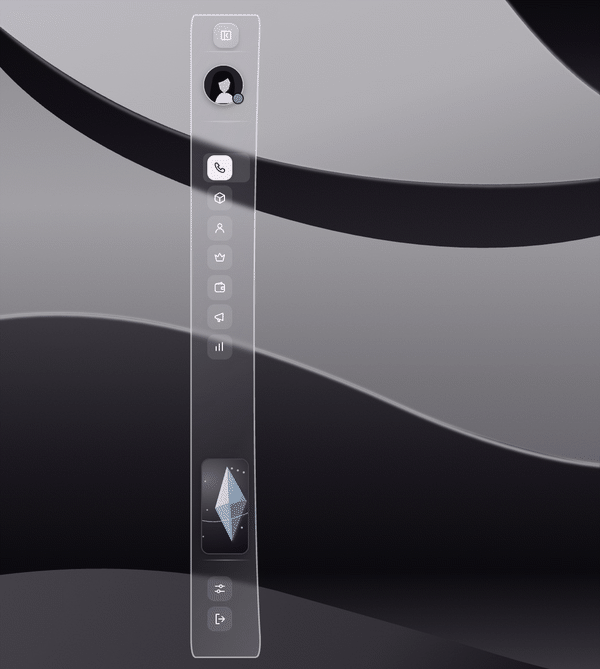
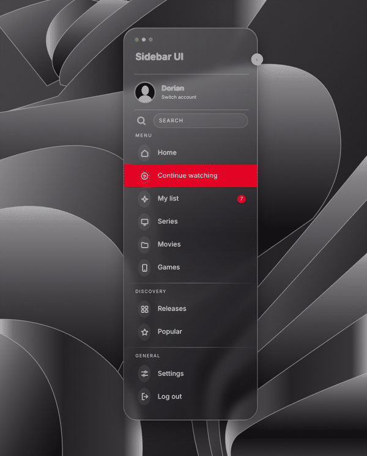
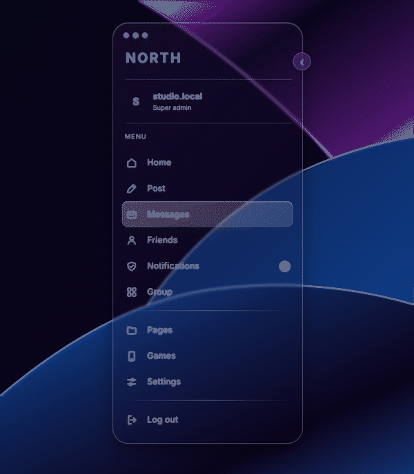

<!-- Generated by .github/scripts/build_catalog.py. Edit that file, not this one. -->
# Sidebars

Sidebars.

Part of [UI](../).

## Designs (5)

<table>
<tr><td align="center" valign="top" width="33%"> <a href="apricot-workspace-sidebar/"><b>Apricot workspace sidebar</b></a> 8 colorways</td><td align="center" valign="top" width="33%"> <a href="curved-crystal-sidebar/"><b>Curved crystal sidebar</b></a> 8 colorways</td><td align="center" valign="top" width="33%"> <a href="scarlet-cinema-sidebar/"><b>Scarlet cinema sidebar</b></a> 8 colorways</td></tr>
<tr><td align="center" valign="top" width="33%"> <a href="ultraviolet-glass-sidebar/"><b>Ultraviolet glass sidebar</b></a> 8 colorways</td><td align="center" valign="top" width="33%"> <a href="violet-signal-sidebar/"><b>Violet signal sidebar</b></a> 8 colorways</td></tr>
</table>

Adding one? See [Adding a design](../../README.md#adding-a-design).
