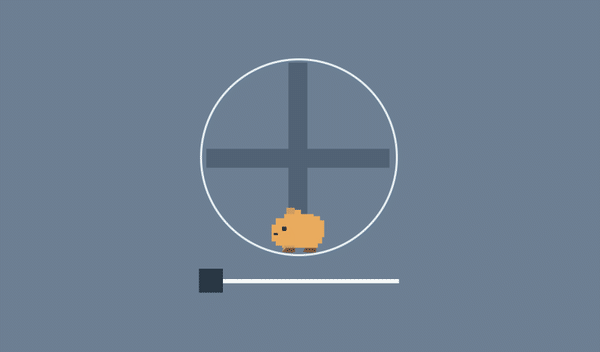
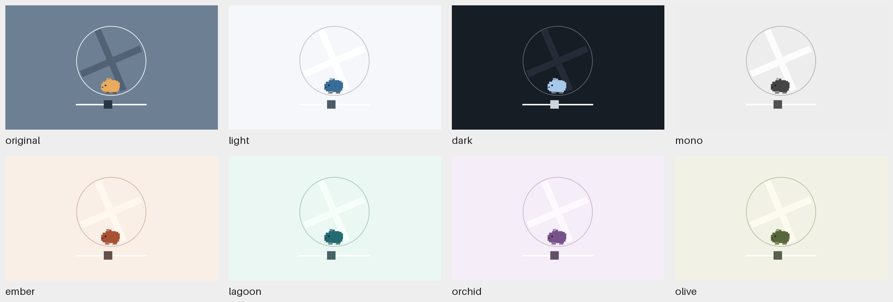

# Hamster wheel speed slider

A tiny golden pixel hamster runs along the bottom of a slate wheel. The square thumb sets the speed of its feet and the four spokes.

| | |
| --- | --- |
| **Category** | [UI › Sliders](../) |
| **Size** | 864 × 507 CSS pixels, exported at 2× |
| **Colorways** | original, light, dark, mono, ember, lagoon, orchid, olive |
| **Fonts** | No lettering in the design |
| **Icons** | Original inline SVG and CSS |
| **Animated** | Yes, 6.2-second loop at 24 fps |
| **Based on** | [A TikTok by @paulcodes4](https://www.tiktok.com/@paulcodes4/video/7693575923471322388) |

## Every colorway

## Files

- Open [the design](source/design.html) in a browser and append `#ember` to select that colorway. Add `?t=3#ember` after the filename to show the export still.
- [The exports folder](exports/) contains a PNG and an H.264 MP4 loop for each colorway.

## Changing it

Drag the range input or use its arrow keys to adjust speed. The hamster, spokes and wheel are original pixel artwork.

The custom properties at the top of `source/design.html` define each palette. Copy a palette block, give it a new colorway name, then run `python3 .github/scripts/export_design.py ui/sliders/hamster-wheel-speed` from the repository root.
