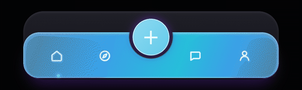
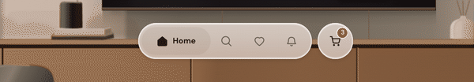
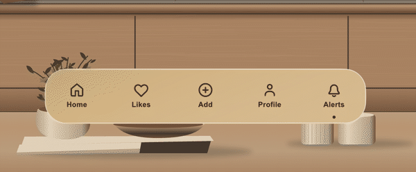
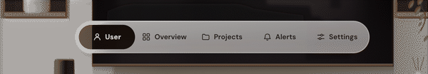
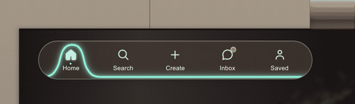
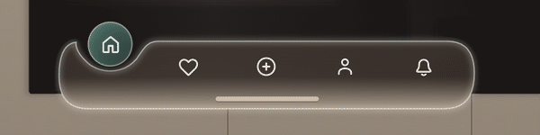
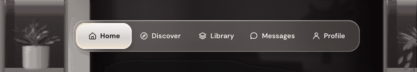
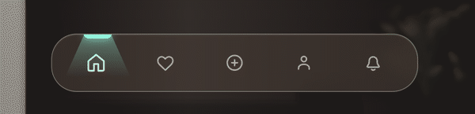
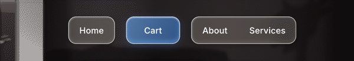

<!-- Generated by .github/scripts/build_catalog.py. Edit that file, not this one. -->
# Tab bars

Bottom tab bars.

Part of [UI](../).

## Designs (9)

<table>
<tr><td align="center" valign="top" width="33%"> <a href="aurora-add-dock/"><b>Aurora add dock</b></a> 8 colorways</td><td align="center" valign="top" width="33%"> <a href="expanding-glass-dock/"><b>Expanding glass dock</b></a> 9 colorways</td><td align="center" valign="top" width="33%"> <a href="honey-drop-tabs/"><b>Honey drop tabs</b></a> 8 colorways</td></tr>
<tr><td align="center" valign="top" width="33%"> <a href="ink-glass-tabs/"><b>Ink glass tabs</b></a> 8 colorways</td><td align="center" valign="top" width="33%"> <a href="mint-wave-tabs/"><b>Mint wave tabs</b></a> 8 colorways</td><td align="center" valign="top" width="33%"> <a href="notched-glass-dock/"><b>Notched glass dock</b></a> 8 colorways</td></tr>
<tr><td align="center" valign="top" width="33%"> <a href="pearl-glass-tabs/"><b>Pearl glass tabs</b></a> 8 colorways</td><td align="center" valign="top" width="33%"> <a href="prism-spotlight-tabs/"><b>Prism spotlight tabs</b></a> 8 colorways</td><td align="center" valign="top" width="33%"> <a href="split-sapphire-tabs/"><b>Split sapphire tabs</b></a> 8 colorways</td></tr>
</table>

Adding one? See [Adding a design](../../README.md#adding-a-design).
