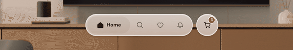
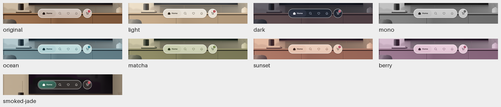

# Expanding glass dock

A compact glass dock opens a text label beside the active icon. A moving lens refracts the wood cabinet behind the rail, beside a separate cart with a count of three.

| | |
| --- | --- |
| **Category** | [UI › Tab bars](../) |
| **Size** | 576 × 100 CSS pixels, exported at 1152 × 200 |
| **Colorways** | original, light, dark, mono, ocean, matcha, sunset, berry, smoked-jade |
| **Font** | DM Sans, an embedded variable-weight subset under the SIL Open Font License. The license is included in the HTML. |
| **Icons and backdrop** | Original inline SVG drawings |
| **Animated** | Yes, 4 seconds at 24 fps |
| **Based on** | [Glassy Navigation Tabs V7 by @paulcodes4](https://www.tiktok.com/@paulcodes4/video/7705318976523357460) and [the smoked jade version in V10](https://www.tiktok.com/@paulcodes4/video/7707167232501091604) |

## Every colorway

## Files

- Open [the standalone design](source/design.html) to try the navigation. The demo opens Search and Saved, then follows a longer drag back to Search. The cart button toggles its pressed state and emits a `cartchange` event with the open state and item count.
- Use the left and right arrow keys to move between destinations. Home and End select the first and last destination. The demo respects reduced motion.
- Add `#ocean` to the address to switch palettes, or `?t=0.2#ocean` to freeze the animation at 0.2 seconds.
- [Exports](exports/) contains one PNG and one H.264 MP4 per colorway.

## Changing it

The palette blocks at the top of `source/design.html` set the colors of the interior, glass and lettering. To add a palette, copy a block, rename it and run `python3 .github/scripts/export_design.py ui/tab-bars/expanding-glass-dock` from the repository root.
