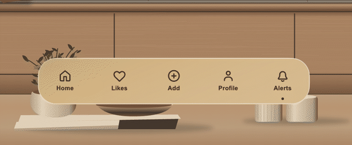
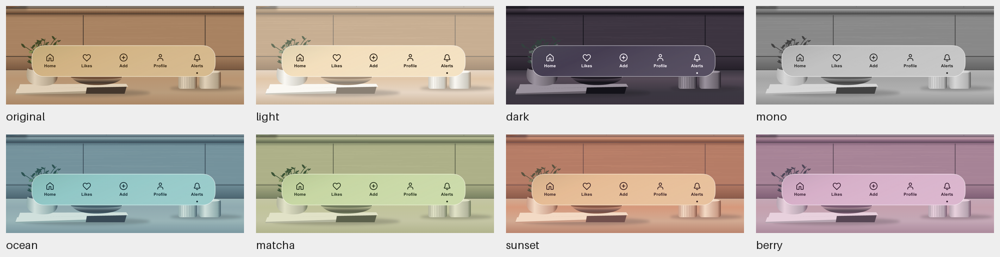

# Honey drop tabs

A tap pulls a labeled icon out of a honey-colored bar like a drop of liquid glass. The drop separates, falls back into the surface and shifts the tint from honey to rose.

| | |
| --- | --- |
| **Category** | [UI › Tab bars](../) |
| **Size** | 576 × 238 CSS px, exported at 2× |
| **Colorways** | original, light, dark, mono, ocean, matcha, sunset, berry |
| **Fonts** | Arial, with Helvetica and sans-serif fallbacks |
| **Icons** | Original SVG strokes |
| **Animated** | Yes, 2.5-second loop at 24 fps |
| **Based on** | [Glassy Navigation Tabs V5 by @paulcodes4](https://www.tiktok.com/@paulcodes4/video/7704943271675546900) |

## Every colorway

## Files

- [source/design.html](source/design.html) is the interactive component. Click a tab or use the arrow keys. Append a colorway such as `#ocean` to change the palette or `?t=0.6#ocean` to inspect a moment.
- [exports/](exports/) contains a PNG and H.264 MP4 for each colorway.

## Changing it

The highlighted glyph rises about 109 px. Two joined shapes stretch into a neck, separate at the top of the arc and rejoin on the way down. Add and Likes demonstrate the two tints. The repeating preview adds a return to the first state. The interior, reflections and furniture are drawn from geometry inside the page. The reference recording is credited above.

The CSS variables at the top of the source set the room and the interface colors together. Duplicate a palette block and run `python3 .github/scripts/export_design.py ui/tab-bars/honey-drop-tabs` from the repository root to refresh the exports.
