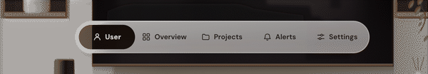
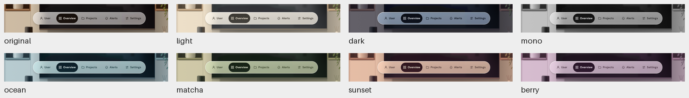

# Ink glass tabs

A dark capsule stretches across a frosted navigation rail. The letters change color at the moving edge, and the scene behind the rail shows through the capsule.

| | |
| --- | --- |
| **Category** | [UI › Tab bars](../) |
| **Size** | 576 × 100 CSS pixels, exported at 1152 × 200 |
| **Colorways** | original, light, dark, mono, ocean, matcha, sunset, berry |
| **Font** | DM Sans, an embedded variable-weight subset under the SIL Open Font License. The license is included in the HTML. |
| **Icons and backdrop** | Original inline SVG drawings |
| **Animated** | Yes, 2.25 seconds at 24 fps |
| **Based on** | [A TikTok by @paulcodes4](https://www.tiktok.com/@paulcodes4/video/7705318976523357460) |

## Every colorway

## Files

- Open [the standalone design](source/design.html) to try the navigation. The demo moves between User and Overview. Select any of the five destinations to move the aperture.
- Use the left and right arrow keys to move between destinations. Home and End select the first and last destination. The demo respects reduced motion.
- Add `#ocean` to the address to switch palettes, or `?t=1.05#ocean` to freeze the animation at 1.05 seconds.
- [Exports](exports/) contains one PNG and one H.264 MP4 per colorway.

## Changing it

The palette blocks at the top of `source/design.html` set the colors of the interior, glass and lettering. To add a palette, copy a block, rename it and run `python3 .github/scripts/export_design.py ui/tab-bars/ink-glass-tabs` from the repository root.
