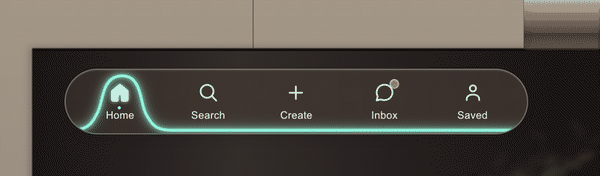
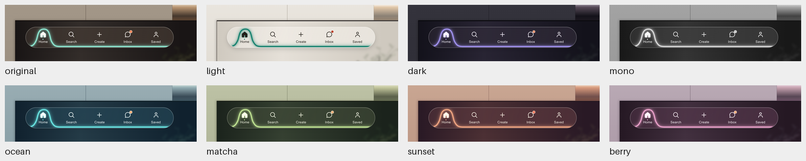

# Mint wave tabs

A mint filament climbs around the active tab and settles back into the edge of a smoked-glass capsule. Search opens a separate glass field above the bar.

| | |
| --- | --- |
| **Category** | [UI › Tab bars](../) |
| **Size** | 576 × 169 CSS px, exported at 2× |
| **Colorways** | original, light, dark, mono, ocean, matcha, sunset, berry |
| **Fonts** | Arial, with Helvetica and sans-serif fallbacks |
| **Icons** | Original SVG strokes |
| **Animated** | Yes, 2.5-second loop at 24 fps |
| **Based on** | [Glassy Navigation Tabs V5 by @paulcodes4](https://www.tiktok.com/@paulcodes4/video/7704943271675546900) |

## Every colorway

## Files

- [source/design.html](source/design.html) is the interactive component. Click a tab or use the arrow keys. Append a colorway such as `#ocean` to change the palette or `?t=0.6#ocean` to inspect a moment.
- [exports/](exports/) contains a PNG and H.264 MP4 for each colorway.

## Changing it

The five tabs sit 84 px apart. The indicator travels one position in about 310 ms, carrying its glow up from the bottom rim. Selecting Search also reveals the separate field. The repeating preview adds a return to the first state. The interior, reflections and furniture are drawn from geometry inside the page. The reference recording is credited above.

The CSS variables at the top of the source set the room and the interface colors together. Duplicate a palette block and run `python3 .github/scripts/export_design.py ui/tab-bars/mint-wave-tabs` from the repository root to refresh the exports.
