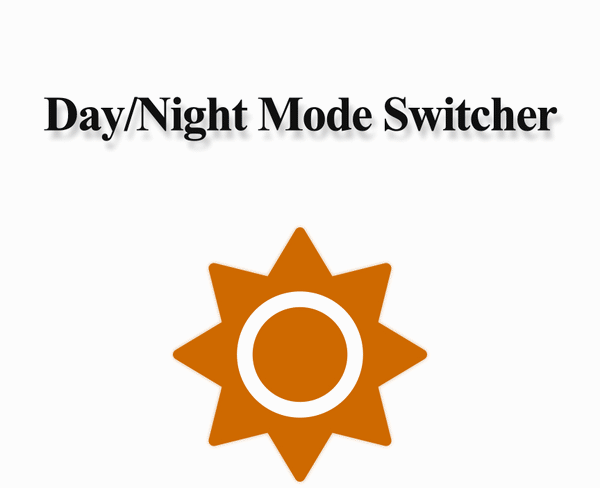
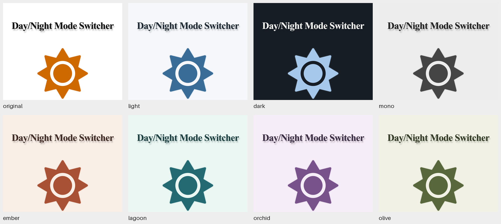

# Eight-ray day and night toggle

An eight-ray amber sun becomes a white crescent on a slate background. A serif mode-switcher heading casts a soft downward shadow above the large control.

| | |
| --- | --- |
| **Category** | [UI › Toggles](../) |
| **Size** | 864 × 702 CSS pixels, exported at 2× |
| **Colorways** | original, light, dark, mono, ember, lagoon, orchid, olive |
| **Fonts** | Times New Roman (system serif, with a browser serif fallback) |
| **Icons** | Original inline SVG and CSS |
| **Animated** | Yes, 9.6-second loop at 24 fps |
| **Based on** | [A TikTok by @paulcodes4](https://www.tiktok.com/@paulcodes4/video/7702504276278627605) |

## Every colorway

## Files

- Open [the design](source/design.html) in a browser and append `#ember` to select that colorway. Add `?t=0.5#ember` after the filename to show the export still.
- [The exports folder](exports/) contains a PNG and an H.264 MP4 loop for each colorway.

## Changing it

Press the sun or crescent to switch the page between the two modes. Each palette supplies day and night backgrounds as well as its own foreground tones.

The custom properties at the top of `source/design.html` define each palette. Copy a palette block, give it a new colorway name, then run `python3 .github/scripts/export_design.py ui/toggles/eight-ray-day-night` from the repository root.
