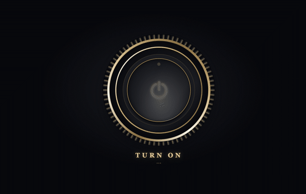
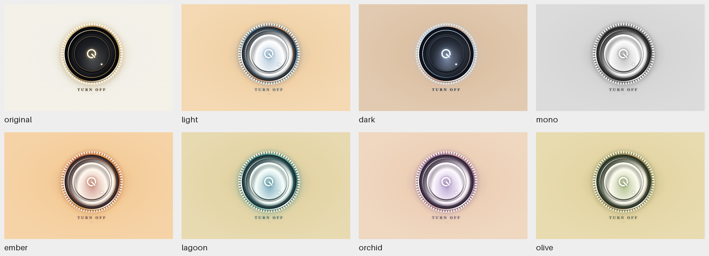

# Knurled brass power switch

A ridged brass rim encloses a dark glass power switch. Turning the control lights its gold halo and changes the page from black to ivory.

| | |
| --- | --- |
| **Category** | [UI › Toggles](../) |
| **Size** | 864 × 549 CSS pixels, exported at 2× |
| **Colorways** | original, light, dark, mono, ember, lagoon, orchid, olive |
| **Fonts** | Georgia (system serif, with a Times New Roman fallback) |
| **Icons** | Original inline SVG and CSS |
| **Animated** | Yes, 5.2-second loop at 24 fps |
| **Based on** | [A TikTok by @paulcodes4](https://www.tiktok.com/@paulcodes4/video/7692332078100139284) |

## Every colorway

## Files

- Open [the design](source/design.html) in a browser and append `#ember` to select that colorway. Add `?t=1.65#ember` after the filename to show the export still.
- [The exports folder](exports/) contains a PNG and an H.264 MP4 loop for each colorway.

## Changing it

Press the dial to rotate the power mark and switch between its light and dark states.

The custom properties at the top of `source/design.html` define each palette. Copy a palette block, give it a new colorway name, then run `python3 .github/scripts/export_design.py ui/toggles/knurled-brass-power` from the repository root.
