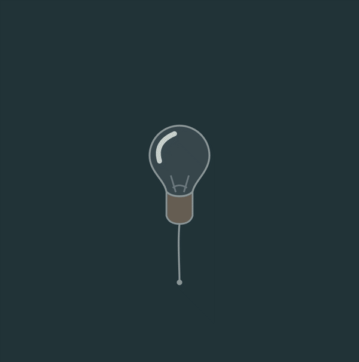
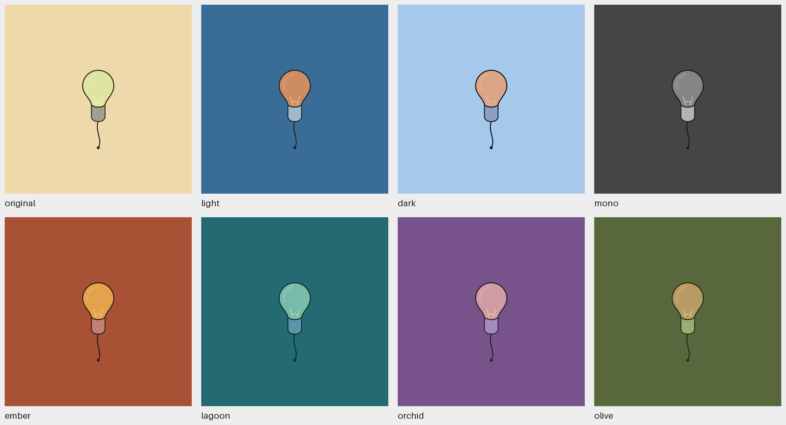

# Pull-cord bulb

A transparent bulb hangs against slate with a single pull cord. Tugging the cord lights the filament, turns the background warm sand and sets the line swinging.

| | |
| --- | --- |
| **Category** | [UI › Toggles](../) |
| **Size** | 864 × 873 CSS pixels, exported at 2× |
| **Colorways** | original, light, dark, mono, ember, lagoon, orchid, olive |
| **Fonts** | No lettering in the design |
| **Icons** | Original inline SVG and CSS |
| **Animated** | Yes, 6.2-second loop at 24 fps |
| **Based on** | [A TikTok by @paulcodes4](https://www.tiktok.com/@paulcodes4/video/7693624353870728454) |

## Every colorway

## Files

- Open [the design](source/design.html) in a browser and append `#ember` to select that colorway. Add `?t=2.62#ember` after the filename to show the export still.
- [The exports folder](exports/) contains a PNG and an H.264 MP4 loop for each colorway.

## Changing it

Drag the cord downward and release it to operate the lamp. A click, Enter or Space also toggles it. The bulb, glass highlight and cord are original SVG artwork.

The custom properties at the top of `source/design.html` define each palette. Copy a palette block, give it a new colorway name, then run `python3 .github/scripts/export_design.py ui/toggles/pull-cord-bulb` from the repository root.
