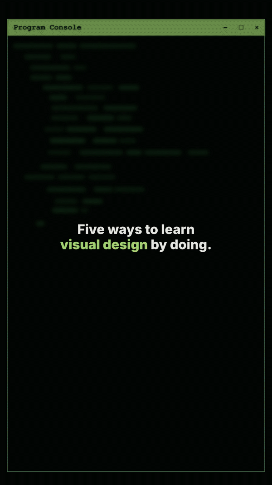
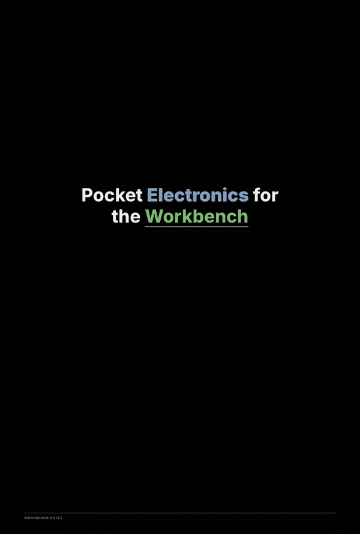

<!-- Generated by .github/scripts/build_catalog.py. Edit that file, not this one. -->
# Shorts

Vertical templates for Shorts, Reels and TikTok.

Part of [Video](../).

## Designs (2)

<table>
<tr><td align="center" valign="top" width="33%"> <a href="phosphor-resource-console/"><b>Phosphor resource console</b></a> 8 colorways</td><td align="center" valign="top" width="33%"> <a href="pocket-electronics-index/"><b>Pocket electronics index</b></a> 8 colorways</td></tr>
</table>

Adding one? See [Adding a design](../../README.md#adding-a-design).
