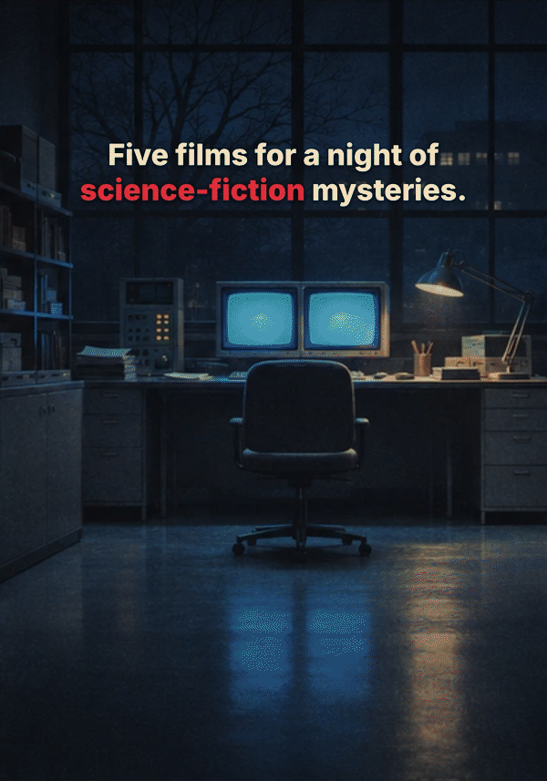
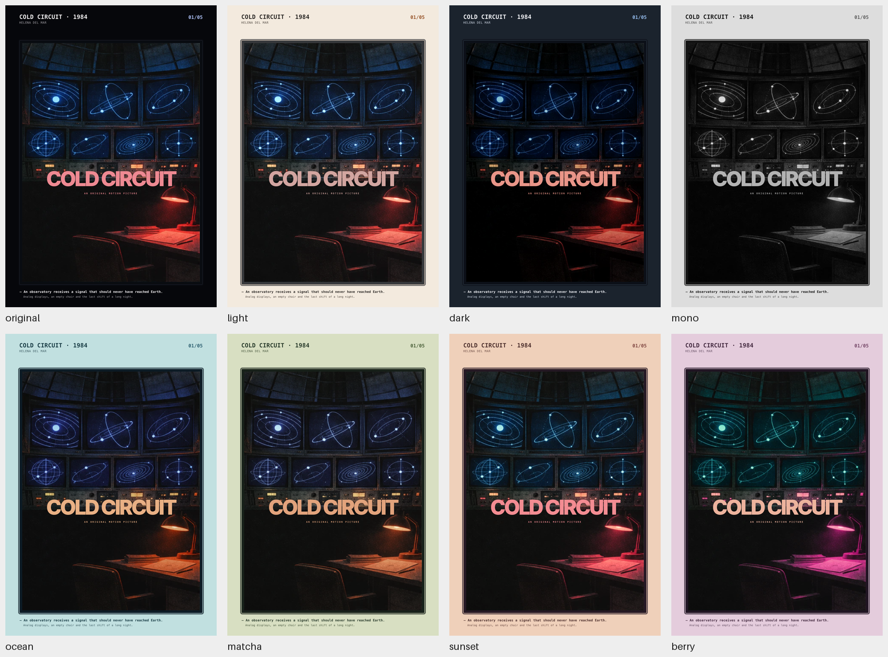

# Midnight film dossier

Five fictional film recommendations share dark catalogue headers, numbered folios, portrait one-sheets and short editorial notes.

| | |
| --- | --- |
| **Category** | [Video › Shorts](../) |
| **Size** | 576 × 823 CSS pixels, exported at 2× |
| **Colorways** | original, light, dark, mono, ocean, matcha, sunset, berry |
| **Fonts** | System monospace and condensed display faces, with embedded Inter under its SIL Open Font License. |
| **Artwork** | Original SVG and CSS |
| **Animated** | Yes, 11.2-second loop at 24 fps |
| **Based on** | [A TikTok by @paulcodes4](https://www.tiktok.com/@paulcodes4/video/7704205160758709524) |

## Every colorway

## Files

- [Open the standalone design](source/design.html). Use the arrow keys, click either side or swipe to browse. Add `?slide=1` through `?slide=5` to open an individual card.
- Add `#ocean` to switch palettes or `?t=3.87#ocean` to freeze the preview.
- [Exports](exports/) contains a PNG and an H.264 MP4 for every colorway.

The six-panel `source/original-film-atlas.webp` was generated with imagegen for this template. Five new fictional posters and a neutral workstation opener replace the film marketing artwork and people in the reference. Poster titles, filmmaker names and notes are fictional.

Every palette also includes all 5 individual cards in `exports/slides/<colorway>/`.

## Changing it

The CSS variables at the top of `source/design.html` control the palette. Copy a palette block, rename it, then run `python3 .github/scripts/export_design.py video/shorts/midnight-film-dossier` from the repository root.
