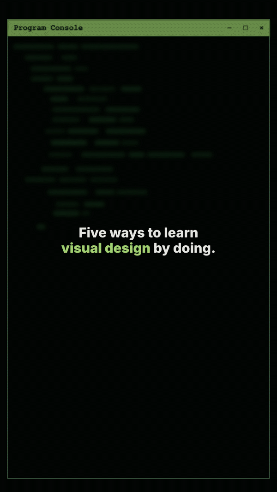
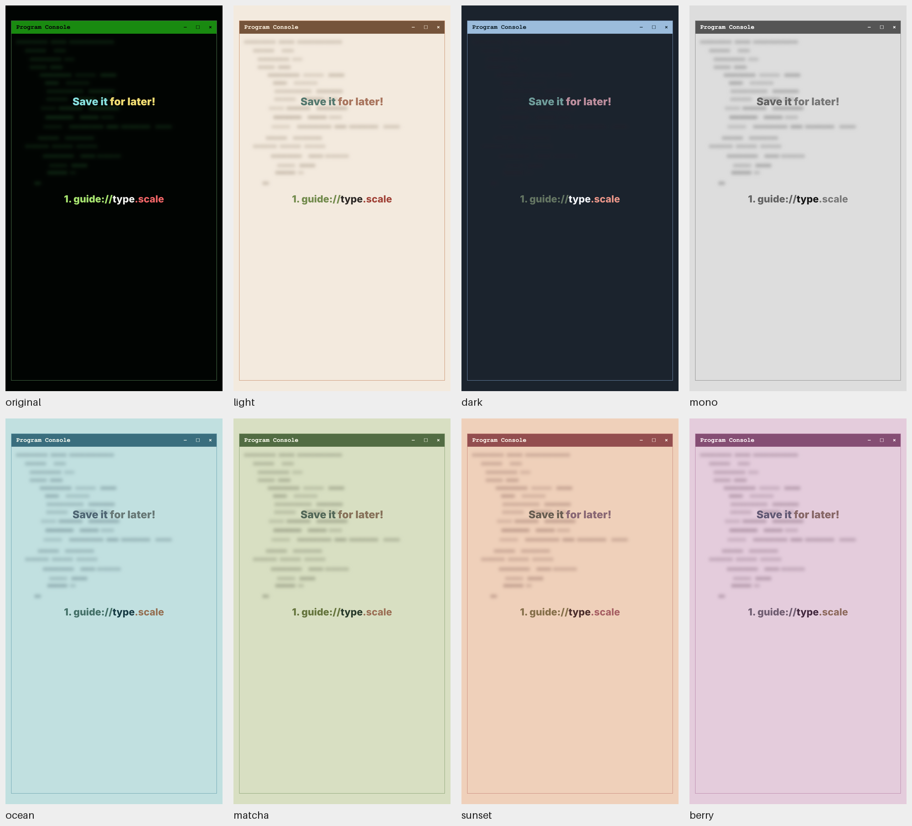

# Phosphor resource console

A glowing green window frame and a faint console texture surround five typed, color-separated design exercise cards.

| | |
| --- | --- |
| **Category** | [Video › Shorts](../) |
| **Size** | 576 × 1024 CSS pixels, exported at 2× |
| **Colorways** | original, light, dark, mono, ocean, matcha, sunset, berry |
| **Fonts** | Inter, embedded under the SIL Open Font License. The HTML includes the license. |
| **Artwork** | Original SVG and CSS |
| **Animated** | Yes, 10.3-second loop at 24 fps |
| **Based on** | [A TikTok by @paulcodes4](https://www.tiktok.com/@paulcodes4/video/7705324965712629013) |

## Every colorway

## Files

- [Open the standalone design](source/design.html). Use the arrow keys, click either side or swipe to browse. Add `?slide=1` through `?slide=5` to open an individual card.
- Add `#ocean` to switch palettes or `?t=5.1#ocean` to freeze the preview.
- [Exports](exports/) contains a PNG and an H.264 MP4 for every colorway.

The five fictional guide addresses label harmless exercises in typography, color, grids, spacing and motion. All console marks are independently drawn.

Every palette also includes all 5 individual cards in `exports/slides/<colorway>/`.

## Changing it

The CSS variables at the top of `source/design.html` control the palette. Copy a palette block, rename it, then run `python3 .github/scripts/export_design.py video/shorts/phosphor-resource-console` from the repository root.
