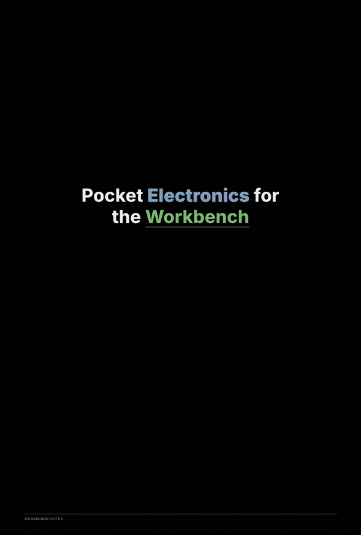
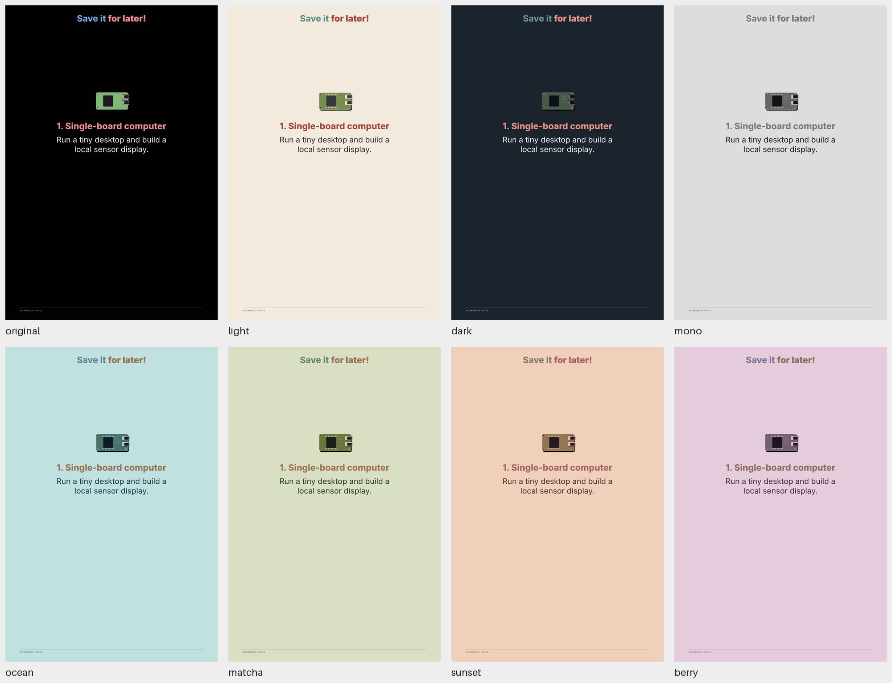

# Pocket electronics index

Ten miniature electronics illustrations sit above numbered color-coded names, a short description and a two-tone bookmark prompt.

| | |
| --- | --- |
| **Category** | [Video › Shorts](../) |
| **Size** | 576 × 854 CSS pixels, exported at 2× |
| **Colorways** | original, light, dark, mono, ocean, matcha, sunset, berry |
| **Fonts** | Inter, embedded under the SIL Open Font License. The HTML includes the license. |
| **Artwork** | Original SVG and CSS |
| **Animated** | Yes, 16.8-second loop at 24 fps |
| **Based on** | [A TikTok by @paulcodes4](https://www.tiktok.com/@paulcodes4/video/7705485136040758549) |

## Every colorway

## Files

- [Open the standalone design](source/design.html). Use the arrow keys, click either side or swipe to browse. Add `?slide=1` through `?slide=10` to open an individual card.
- Add `#ocean` to switch palettes or `?t=5.77#ocean` to freeze the preview.
- [Exports](exports/) contains a PNG and an H.264 MP4 for every colorway.

The ten devices are independently drawn, unbranded electronics examples. The reference recording includes a small Hacker339 signature.

Every palette also includes all 10 individual cards in `exports/slides/<colorway>/`.

## Changing it

The CSS variables at the top of `source/design.html` control the palette. Copy a palette block, rename it, then run `python3 .github/scripts/export_design.py video/shorts/pocket-electronics-index` from the repository root.
