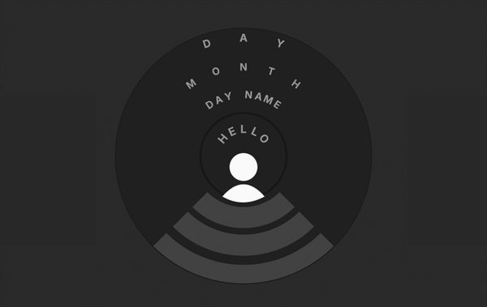
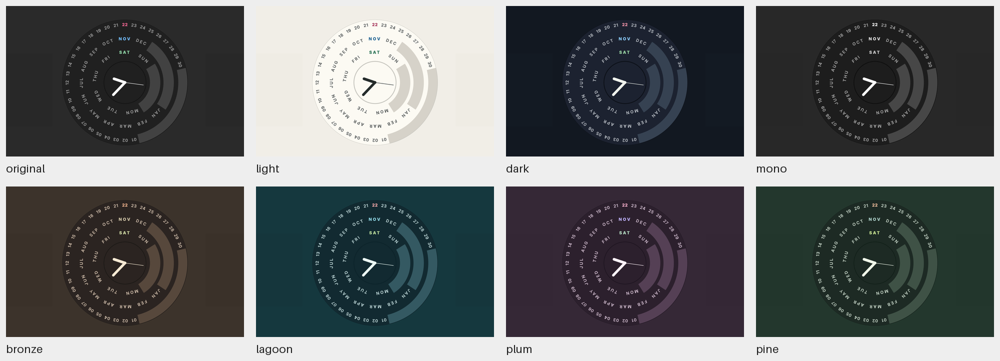

# Calendar ring dial

Three charcoal rings unfold from a greeting into the date, month and weekday around an analog clock. Pink, blue and green mark the selected values at twelve o’clock.

| | |
| --- | --- |
| **Category** | [Watch › Watch faces](../) |
| **Size** | 864 × 546 CSS pixels, exported at 2× |
| **Colorways** | original, light, dark, mono, bronze, lagoon, plum, pine |
| **Fonts** | Inter (bundled Latin subset from Google Fonts, SIL Open Font License) |
| **Icons** | Original inline SVG and CSS |
| **Animated** | Yes, 5-second loop at 24 fps |
| **Based on** | [A TikTok by @paulcodes4](https://www.tiktok.com/@paulcodes4/video/7707171802707021077) · [Second post by @paulcodes4](https://www.tiktok.com/@paulcodes4/video/7691654511357840660) |

## Every colorway

## Files

- Open [the design](source/design.html) in a browser and append `#bronze` to select that colorway. Add `?t=3.3#bronze` after the filename to show the export still.
- [The exports folder](exports/) contains a PNG and an H.264 MP4 loop for each colorway.
- [The font folder](source/fonts/) includes the font files and their licenses.

## Changing it

The export shows Saturday 22 November from the reference. Click the dial to display local time and replay the three ring reveals. The hands use independent Web Animations tracks.

The custom properties at the top of `source/design.html` define each palette. Copy a palette block, give it a new colorway name, then run `python3 .github/scripts/export_design.py watch/watch-faces/calendar-ring-dial` from the repository root.
