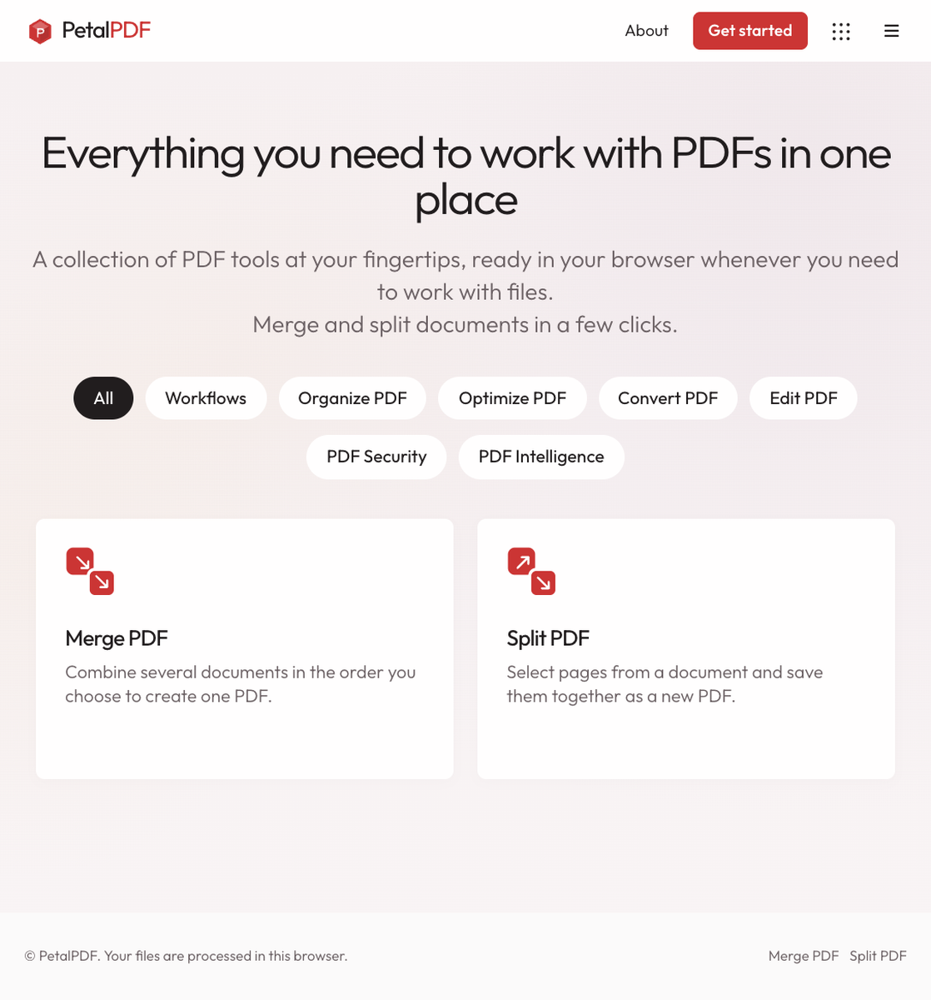
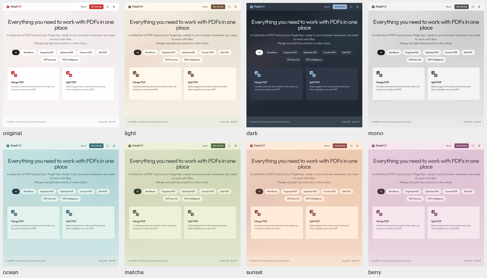

# Petal document toolkit

A blush document directory with stacked file icons, pill filters and two working local PDF tools.

| | |
| --- | --- |
| **Category** | [Web › App sites](../) |
| **Size** | 544 × 584 CSS pixels, exported at 2× |
| **Colorways** | original, light, dark, mono, ocean, matcha, sunset, berry |
| **Fonts** | Outfit, embedded under the SIL Open Font License. The HTML includes the license. |
| **Artwork** | Original SVG and CSS |
| **Animated** | No |
| **Based on** | [A TikTok by @paulcodes4](https://www.tiktok.com/@paulcodes4/video/7702718771554798868) and [a second view by @paulcodes4](https://www.tiktok.com/@paulcodes4/video/7691597144574151957) |

## Every colorway

## Files

- [Open the standalone design](source/design.html). Select Merge PDF to combine files in file-picker order, or choose Split PDF to extract a page or a comma-separated sequence of page ranges.
- Add `#ocean` to switch palettes.
- [Exports](exports/) contains a PNG for every colorway.

Document processing uses the bundled [pdf-lib 1.17.1](https://github.com/Hopding/pdf-lib/releases/tag/v1.17.1). Its [MIT license](source/vendor/pdf-lib-LICENSE.md) accompanies the standalone browser build.

## Changing it

The CSS variables at the top of `source/design.html` control the palette. Copy a palette block, rename it, then run `python3 .github/scripts/export_design.py web/app-sites/petal-document-toolkit` from the repository root.
