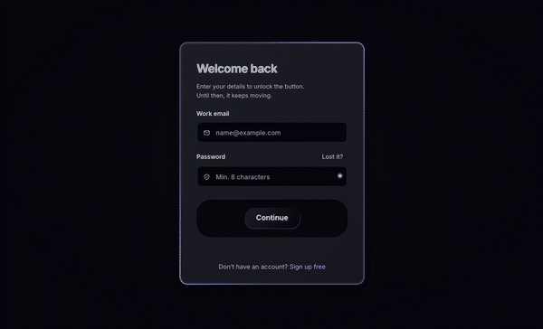
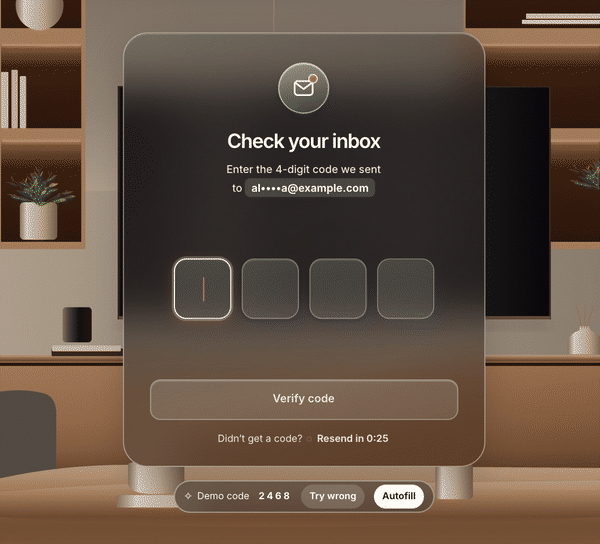

<!-- Generated by .github/scripts/build_catalog.py. Edit that file, not this one. -->
# Auth pages

Sign-in, sign-up and password reset pages.

Part of [Web](../).

## Designs (4)

<table>
<tr><td align="center" valign="top" width="33%"> <a href="iridescent-code-entry/"><b>Iridescent code entry</b></a> 8 colorways</td><td align="center" valign="top" width="33%"> <a href="pleated-lamp-login/"><b>Pleated lamp login</b></a> 8 colorways</td><td align="center" valign="top" width="33%"> <a href="tethered-login-button/"><b>Tethered login button</b></a> 8 colorways</td></tr>
<tr><td align="center" valign="top" width="33%"> <a href="walnut-inbox-verification/"><b>Walnut inbox verification</b></a> 8 colorways</td></tr>
</table>

Adding one? See [Adding a design](../../README.md#adding-a-design).
