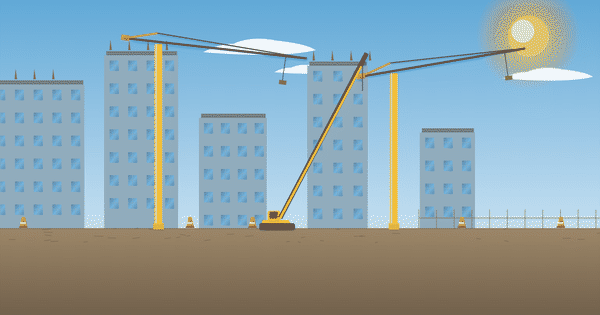
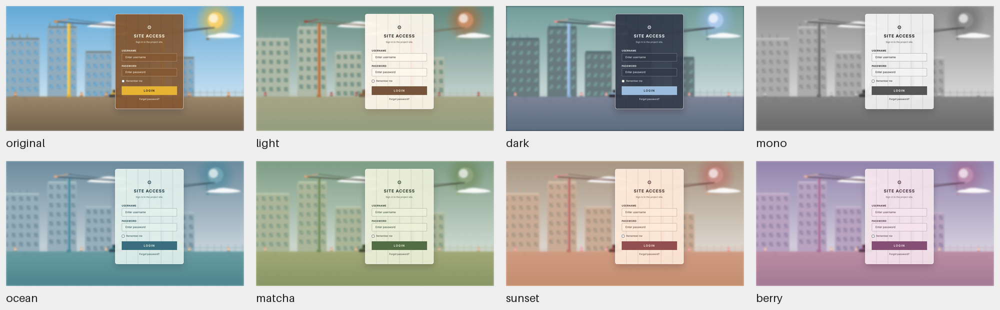

# Construction site access

Yellow tower cranes sweep across a construction yard while a timber access panel rises off the ground and brings the form into focus.

| | |
| --- | --- |
| **Category** | [Web › Auth pages](../) |
| **Size** | 576 × 302 CSS pixels, exported at 2× |
| **Colorways** | original, light, dark, mono, ocean, matcha, sunset, berry |
| **Fonts** | Inter, embedded under the SIL Open Font License. The HTML includes the license. |
| **Artwork** | Original SVG and CSS |
| **Animated** | Yes, 6.8-second loop at 24 fps |
| **Based on** | [A TikTok by @paulcodes4](https://www.tiktok.com/@paulcodes4/video/7704946713987108116) |

## Every colorway

## Files

- [Open the standalone design](source/design.html). Click the construction site to lift the panel, then use the local sign-in form.
- Add `#ocean` to switch palettes or `?t=6.1#ocean` to freeze the preview.
- [Exports](exports/) contains a PNG and an H.264 MP4 for every colorway.

## Changing it

The CSS variables at the top of `source/design.html` control the palette. Copy a palette block, rename it, then run `python3 .github/scripts/export_design.py web/auth-pages/construction-site-access` from the repository root.
