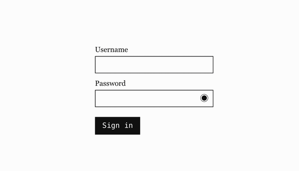
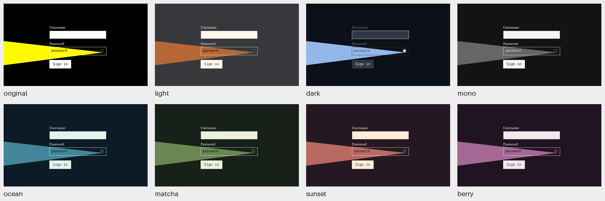

# Flashlight password reveal

A bare username and password form switches into darkness. The eye button casts a sharp yellow beam across the revealed password.

| | |
| --- | --- |
| **Category** | [Web › Auth pages](../) |
| **Size** | 576 × 329 CSS pixels, exported at 2× |
| **Colorways** | original, light, dark, mono, ocean, matcha, sunset, berry |
| **Fonts** | Georgia for labels and the system monospace face for the fields and submit button. |
| **Artwork** | Original SVG and CSS |
| **Animated** | Yes, 5-second loop at 24 fps |
| **Based on** | [A TikTok by @paulcodes4](https://www.tiktok.com/@paulcodes4/video/7699756492630674709) |

## Every colorway

## Files

- [Open the standalone design](source/design.html). Type a password and click the eye to reveal it. Move the pointer to aim the light.
- Add `#ocean` to switch palettes or `?t=3.35#ocean` to freeze the preview.
- [Exports](exports/) contains a PNG and an H.264 MP4 for every colorway.

## Changing it

The CSS variables at the top of `source/design.html` control the palette. Copy a palette block, rename it, then run `python3 .github/scripts/export_design.py web/auth-pages/flashlight-password-reveal` from the repository root.
