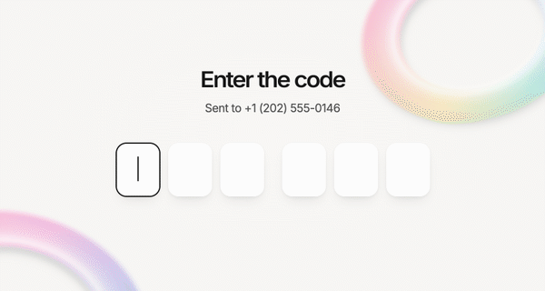
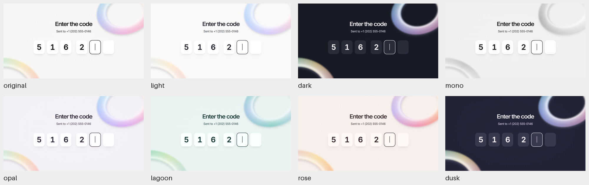

# Iridescent code entry

Two pearlescent arcs frame a six-digit verification field. Each digit lands in its own tile before the group gives way to a drawn checkmark.

| | |
| --- | --- |
| **Category** | [Web › Auth pages](../) |
| **Size** | 900 × 480 CSS pixels, exported at 2× |
| **Colorways** | original, light, dark, mono, opal, lagoon, rose, dusk |
| **Fonts** | Inter (bundled Latin subset from Google Fonts, SIL Open Font License) |
| **Icons** | Original inline SVG and CSS |
| **Animated** | Yes, 6-second loop at 24 fps |
| **Based on** | [A TikTok by @charles.unemployed](https://www.tiktok.com/@charles.unemployed/video/7704297380790799634) |

## Every colorway

## Files

- Open [the design](source/design.html) in a browser and append `#opal` to select that colorway. Add `?t=1.65#opal` after the filename to show the export still.
- [The exports folder](exports/) contains a PNG and an H.264 MP4 loop for each colorway.
- [The font folder](source/fonts/) includes the font files and their licenses.

## Changing it

Click a tile or type a digit to take over the demonstration. Enter the local sample code **516204**, paste it, or choose the sample autofill suggestion. Other six-digit entries show the error state. Press Escape to restart the loop. The page never sends an SMS or submits an entry.

The custom properties at the top of `source/design.html` define each palette. Copy a palette block, give it a new colorway name, then run `python3 .github/scripts/export_design.py web/auth-pages/iridescent-code-entry` from the repository root.

The advancing focus ring and the success check give each state change a visible beginning and end. [Motion timing examples by @charles.unemployed](https://www.tiktok.com/@charles.unemployed/video/7704685504305876242)
