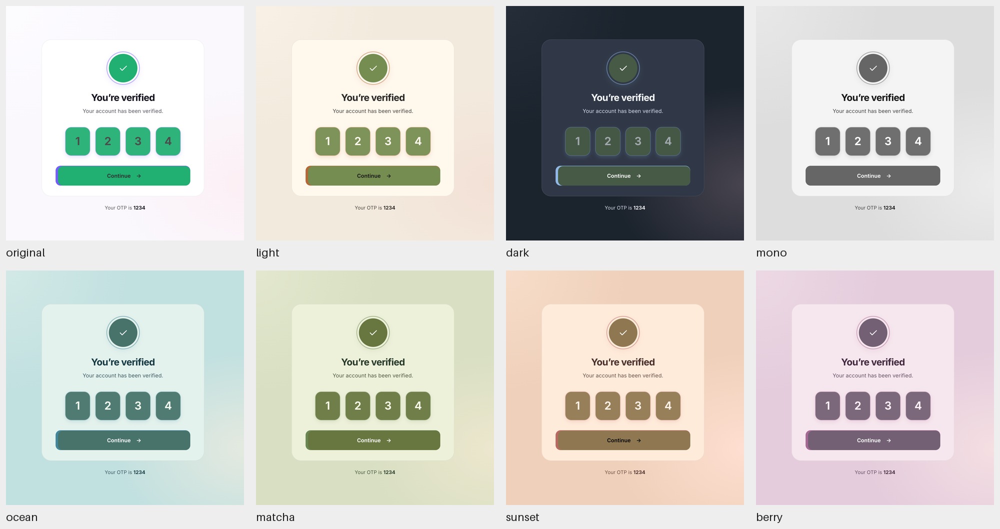

# Lavender verification tiles

Four raised code tiles sit under a lavender lock badge. The button fills with each digit and the card contracts into a green confirmation.

| | |
| --- | --- |
| **Category** | [Web › Auth pages](../) |
| **Size** | 576 × 568 CSS pixels, exported at 2× |
| **Colorways** | original, light, dark, mono, ocean, matcha, sunset, berry |
| **Fonts** | Inter, embedded under the SIL Open Font License. The HTML includes the license. |
| **Artwork** | Original SVG and CSS |
| **Animated** | Yes, 5.7-second loop at 24 fps |
| **Based on** | [A TikTok by @paulcodes4](https://www.tiktok.com/@paulcodes4/video/7701017395980193044) |

## Every colorway

## Files

- [Open the standalone design](source/design.html). Enter 1234 to see the verified state. Paste a code or use Backspace and the arrow keys to move between cells. Resend starts again.
- Add `#ocean` to switch palettes or `?t=3.25#ocean` to freeze the preview.
- [Exports](exports/) contains a PNG and an H.264 MP4 for every colorway.

## Changing it

The CSS variables at the top of `source/design.html` control the palette. Copy a palette block, rename it, then run `python3 .github/scripts/export_design.py web/auth-pages/lavender-verification-tiles` from the repository root.
