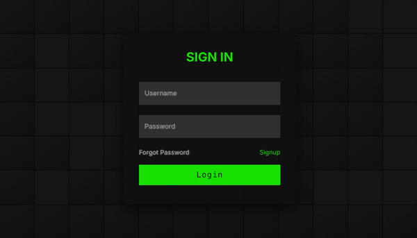
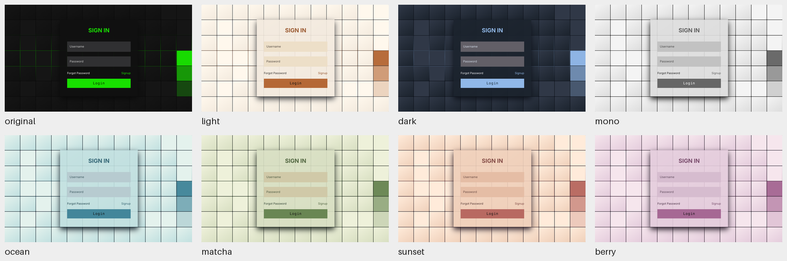

# Phosphor grid sign-in

A strip of green light scans across black tiles behind a dark sign-in panel. Individual tiles flash under the cursor.

| | |
| --- | --- |
| **Category** | [Web › Auth pages](../) |
| **Size** | 528 × 302 CSS pixels, exported at 2× |
| **Colorways** | original, light, dark, mono, ocean, matcha, sunset, berry |
| **Fonts** | Inter with a monospace submit label. Inter is embedded under the SIL Open Font License. |
| **Artwork** | Original SVG and CSS |
| **Animated** | Yes, 4.5-second loop at 24 fps |
| **Based on** | [A TikTok by @paulcodes4](https://www.tiktok.com/@paulcodes4/video/7697526972217314581) |

## Every colorway

## Files

- [Open the standalone design](source/design.html). Move over a tile to illuminate it, then use the sign-in form or its signup link.
- Add `#ocean` to switch palettes or `?t=2.21#ocean` to freeze the preview.
- [Exports](exports/) contains a PNG and an H.264 MP4 for every colorway.

## Changing it

The CSS variables at the top of `source/design.html` control the palette. Copy a palette block, rename it, then run `python3 .github/scripts/export_design.py web/auth-pages/phosphor-grid-sign-in` from the repository root.
