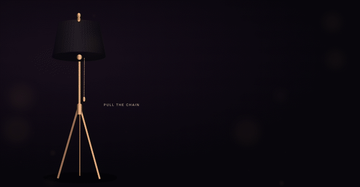
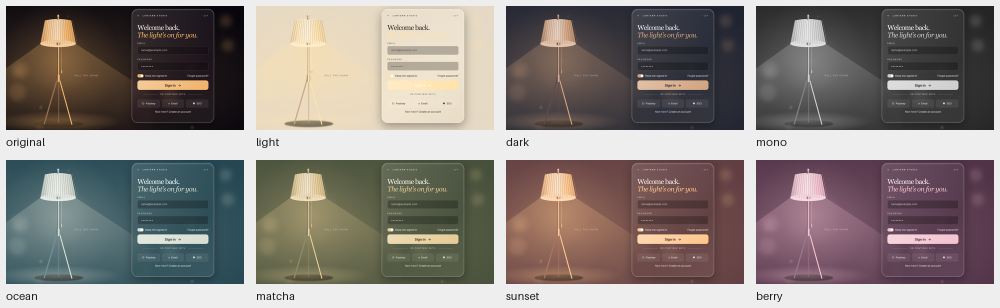

# Pleated lamp login

A pleated tripod lamp casts a cone of light across a dark stage. Pulling the chain reveals a glass sign-in form, and the preview shifts from amber to rose before dimming.

| | |
| --- | --- |
| **Category** | [Web › Auth pages](../) |
| **Size** | 576 × 300 CSS pixels, exported at 2× |
| **Colorways** | original, light, dark, mono, ocean, matcha, sunset, berry |
| **Fonts** | Inter with Georgia display text. Inter is embedded under the SIL Open Font License. |
| **Artwork** | Original SVG and CSS |
| **Animated** | Yes, 5.5-second loop at 24 fps |
| **Based on** | [A TikTok by @paulcodes4](https://www.tiktok.com/@paulcodes4/video/7707360061710142740) |

## Every colorway

## Files

- [Open the standalone design](source/design.html). Pull the chain to toggle the lamp. The email and password fields, local sign-in feedback and account controls are interactive.
- Add `#ocean` to switch palettes or `?t=2.7#ocean` to freeze the preview.
- [Exports](exports/) contains a PNG and an H.264 MP4 for every colorway.

## Changing it

The CSS variables at the top of `source/design.html` control the palette. Copy a palette block, rename it, then run `python3 .github/scripts/export_design.py web/auth-pages/pleated-lamp-login` from the repository root.
