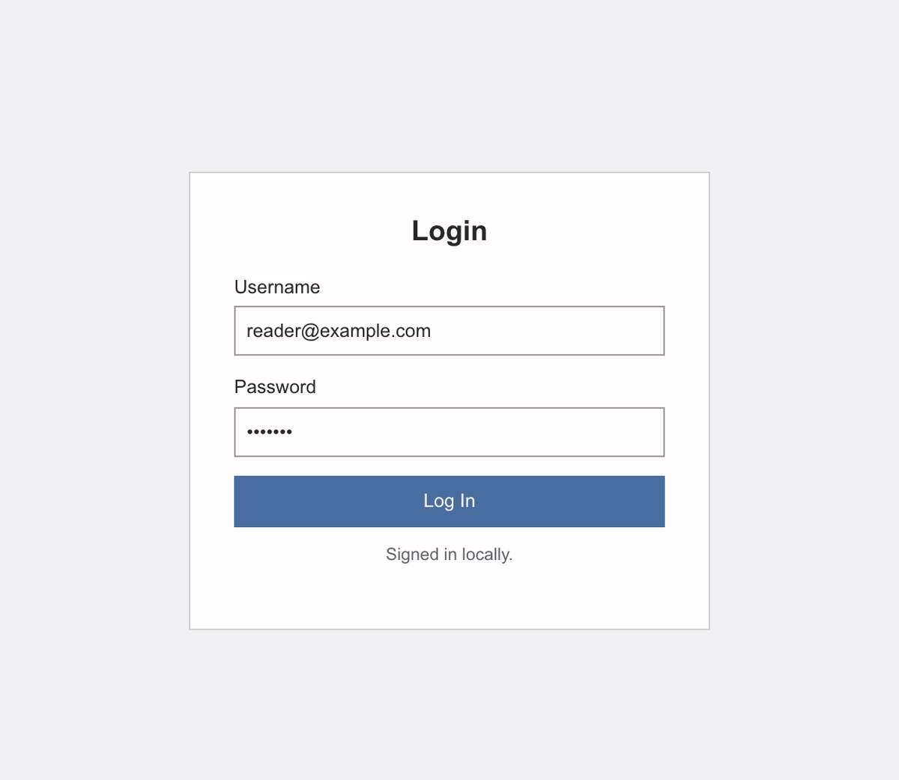
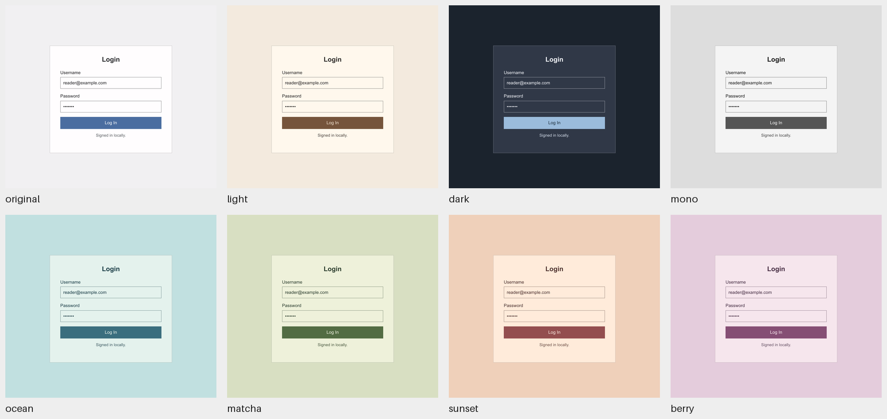

# Simple blue login

A small white form with square text fields and a blue submit bar is the recording’s opening login example.

| | |
| --- | --- |
| **Category** | [Web › Auth pages](../) |
| **Size** | 576 × 500 CSS pixels, exported at 2× |
| **Colorways** | original, light, dark, mono, ocean, matcha, sunset, berry |
| **Fonts** | Arial with a generic sans-serif fallback, matching the opening example. |
| **Artwork** | Original SVG and CSS |
| **Animated** | No |
| **Based on** | [A TikTok by @paulcodes4](https://www.tiktok.com/@paulcodes4/video/7698432465475620116) |

## Every colorway

## Files

- [Open the standalone design](source/design.html). The demo is prefilled. Edit the local values and press Log In.
- Add `#ocean` to switch palettes.
- [Exports](exports/) contains a PNG for every colorway.

## Changing it

The CSS variables at the top of `source/design.html` control the palette. Copy a palette block, rename it, then run `python3 .github/scripts/export_design.py web/auth-pages/simple-blue-login` from the repository root.
