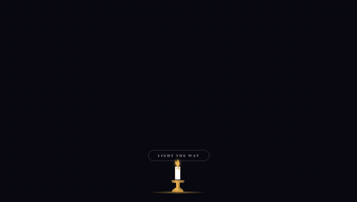
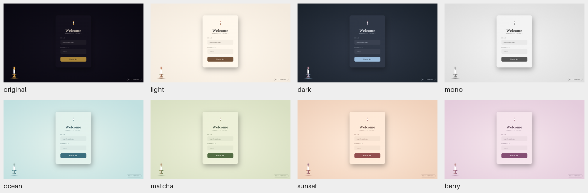

# Taperlight candle login

A small taper in a brass holder lights a dark room and reveals a gilded sign-in form. Extinguishing the flame returns the candle to center stage.

| | |
| --- | --- |
| **Category** | [Web › Auth pages](../) |
| **Size** | 576 × 326 CSS pixels, exported at 2× |
| **Colorways** | original, light, dark, mono, ocean, matcha, sunset, berry |
| **Fonts** | Georgia or the local serif fallback. |
| **Artwork** | Original SVG and CSS |
| **Animated** | Yes, 5.8-second loop at 24 fps |
| **Based on** | [A TikTok by @paulcodes4](https://www.tiktok.com/@paulcodes4/video/7700132190457318677) |

## Every colorway

## Files

- [Open the standalone design](source/design.html). Light the candle, enter the local demo details and select Sign In. Extinguish resets the scene.
- Add `#ocean` to switch palettes or `?t=3.0#ocean` to freeze the preview.
- [Exports](exports/) contains a PNG and an H.264 MP4 for every colorway.

## Changing it

The CSS variables at the top of `source/design.html` control the palette. Copy a palette block, rename it, then run `python3 .github/scripts/export_design.py web/auth-pages/taperlight-candle-login` from the repository root.
