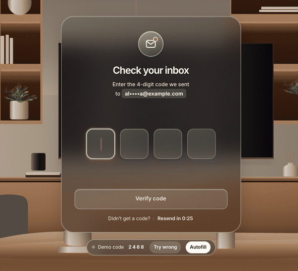
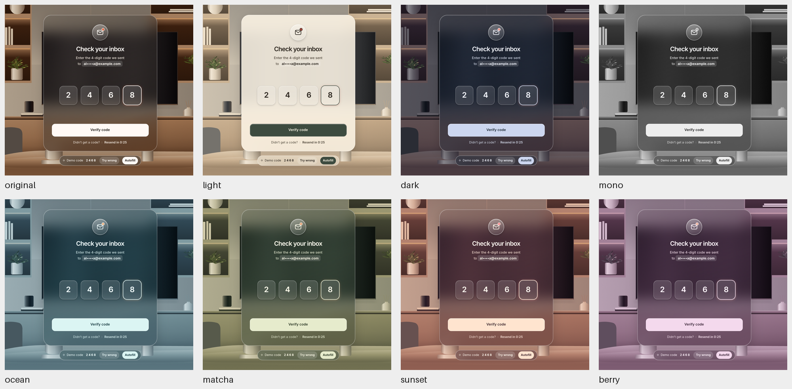

# Walnut inbox verification

A smoked-glass four-digit inbox check sits over a walnut media cabinet. The four tiles move into a square, draw a luminous cross and fold into a green confirmation.

| | |
| --- | --- |
| **Category** | [Web › Auth pages](../) |
| **Size** | 576 × 522 CSS pixels, exported at 2× |
| **Colorways** | original, light, dark, mono, ocean, matcha, sunset, berry |
| **Fonts** | Inter, embedded under the SIL Open Font License. The HTML includes the license. |
| **Artwork** | Original SVG and CSS |
| **Animated** | Yes, 5.75-second loop at 24 fps |
| **Based on** | [A TikTok by @paulcodes4](https://www.tiktok.com/@paulcodes4/video/7710619481311038741) |

## Every colorway

## Files

- [Open the standalone design](source/design.html). Enter the demo code 2468, use Autofill, or try a wrong code. Verification runs locally.
- Add `#ocean` to switch palettes or `?t=1.02#ocean` to freeze the preview.
- [Exports](exports/) contains a PNG and an H.264 MP4 for every colorway.

## Changing it

The CSS variables at the top of `source/design.html` control the palette. Copy a palette block, rename it, then run `python3 .github/scripts/export_design.py web/auth-pages/walnut-inbox-verification` from the repository root.
