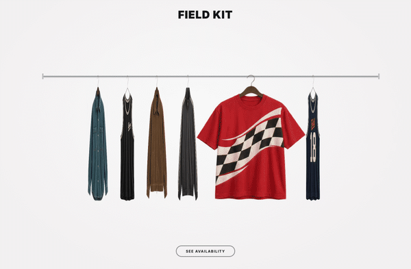
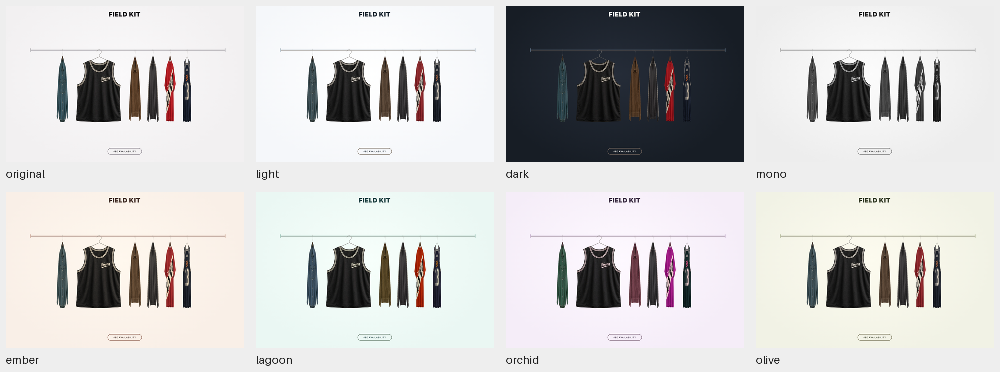

# Field kit clothes rail

Six garments share a suspended clothes rail. Each unfolds as the selection travels across the rack, then moves forward into a focused jersey detail.

| | |
| --- | --- |
| **Category** | [Web › E-commerce](../) |
| **Size** | 1152 × 754 CSS pixels, exported at 2× |
| **Colorways** | original, light, dark, mono, ember, lagoon, orchid, olive |
| **Fonts** | Inter (bundled Latin subset from Google Fonts, SIL Open Font License) |
| **Icons** | Original inline SVG and CSS |
| **Animated** | Yes, 5.9-second loop at 24 fps |
| **Based on** | [A TikTok by @paulcodes4](https://www.tiktok.com/@paulcodes4/video/7701016003332918534) |

## Every colorway

## Files

- Open [the design](source/design.html) in a browser and append `#ember` to select that colorway. Add `?t=1.12#ember` after the filename to show the export still.
- [The exports folder](exports/) contains a PNG and an H.264 MP4 loop for each colorway.
- [The font folder](source/fonts/) includes the font files and their licenses.

## Changing it

Hover, focus or tap an item to turn it on its hanger. Open availability to inspect its name, finish and sizes. The fictional clothing collection is original AI-generated product photography, supplied as a transparent image atlas.

The custom properties at the top of `source/design.html` define each palette. Copy a palette block, give it a new colorway name, then run `python3 .github/scripts/export_design.py web/e-commerce/field-kit-clothes-rail` from the repository root.
