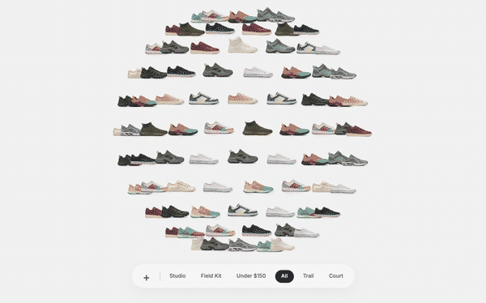
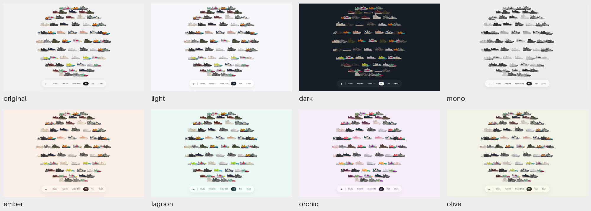

# Orbital sneaker catalog

Rows of floating shoes form a rotating globe over a quiet filter bar. An individual sneaker opens in a white product detail while its neighbors fade into a grid.

| | |
| --- | --- |
| **Category** | [Web › E-commerce](../) |
| **Size** | 1152 × 718 CSS pixels, exported at 2× |
| **Colorways** | original, light, dark, mono, ember, lagoon, orchid, olive |
| **Fonts** | Inter (bundled Latin subset from Google Fonts, SIL Open Font License) |
| **Icons** | Original inline SVG and CSS |
| **Animated** | Yes, 18-second loop at 24 fps |
| **Based on** | [A TikTok by @paulcodes4](https://www.tiktok.com/@paulcodes4/video/7693975954368089350) |

## Every colorway

## Files

- Open [the design](source/design.html) in a browser and append `#ember` to select that colorway. Add `?t=1.9#ember` after the filename to show the export still.
- [The exports folder](exports/) contains a PNG and an H.264 MP4 loop for each colorway.
- [The font folder](source/fonts/) includes the font files and their licenses.

## Changing it

Drag or use the arrow keys to rotate the display. Select a shoe to inspect its price and add it to the local bag. Use the toolbar to filter by collection, price, style and finish. Sixteen unbranded shoes form the original generated product atlas.

The custom properties at the top of `source/design.html` define each palette. Copy a palette block, give it a new colorway name, then run `python3 .github/scripts/export_design.py web/e-commerce/orbital-sneaker-catalog` from the repository root.
