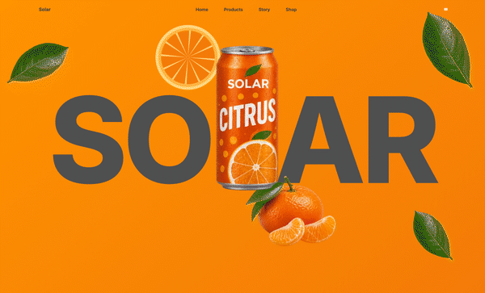
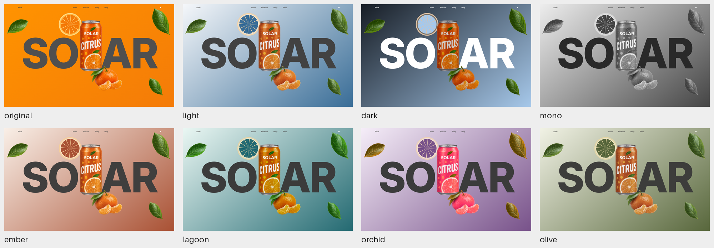

# Solar citrus soda

An orange soda can floats in front of oversized lettering, tangerines and falling leaves. It travels through a dark flavor story into a three-can shop.

| | |
| --- | --- |
| **Category** | [Web › E-commerce](../) |
| **Size** | 1048 × 634 CSS pixels, exported at 2× |
| **Colorways** | original, light, dark, mono, ember, lagoon, orchid, olive |
| **Fonts** | Inter (bundled Latin subset from Google Fonts, SIL Open Font License) |
| **Icons** | Original inline SVG and CSS |
| **Animated** | Yes, 8-second loop at 24 fps |
| **Based on** | [A TikTok by @paulcodes4](https://www.tiktok.com/@paulcodes4/video/7694553826979777798) |

## Every colorway

## Files

- Open [the design](source/design.html) in a browser and append `#ember` to select that colorway. Add `?t=1#ember` after the filename to show the export still.
- [The exports folder](exports/) contains a PNG and an H.264 MP4 loop for each colorway.
- [The font folder](source/fonts/) includes the font files and their licenses.

## Changing it

Scroll, drag, use the navigation or keyboard arrows to travel between the hero, flavor story and shop. Each fictional soda, label, leaf and citrus still life is original generated artwork.

The custom properties at the top of `source/design.html` define each palette. Copy a palette block, give it a new colorway name, then run `python3 .github/scripts/export_design.py web/e-commerce/solar-citrus-soda` from the repository root.
