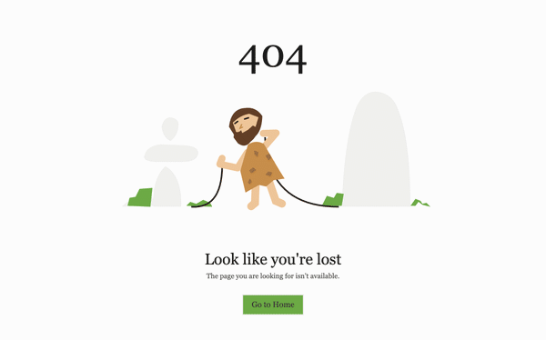
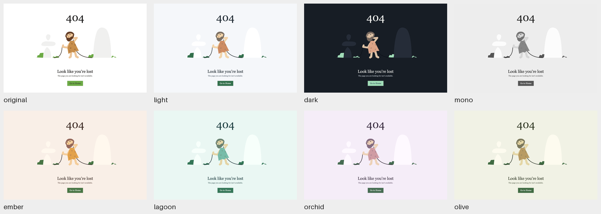

# Lost at the stones

A cave explorer tugs a loose cable between pale standing stones. A flash lifts the explorer off the ground above a green recovery button.

| | |
| --- | --- |
| **Category** | [Web › Error pages](../) |
| **Size** | 1096 × 684 CSS pixels, exported at 2× |
| **Colorways** | original, light, dark, mono, ember, lagoon, orchid, olive |
| **Fonts** | Georgia (system serif, with a Times New Roman fallback) |
| **Icons** | Original inline SVG and CSS |
| **Animated** | Yes, 10-second loop at 24 fps |
| **Based on** | [A TikTok by @paulcodes4](https://www.tiktok.com/@paulcodes4/video/7693226611684019477) |

## Every colorway

## Files

- Open [the design](source/design.html) in a browser and append `#ember` to select that colorway. Add `?t=3#ember` after the filename to show the export still.
- [The exports folder](exports/) contains a PNG and an H.264 MP4 loop for each colorway.

## Changing it

The explorer, cable, stone piles, plants and electrical flash are original vector artwork. The recovery button uses browser history when available and replays the piece in a standalone preview.

The custom properties at the top of `source/design.html` define each palette. Copy a palette block, give it a new colorway name, then run `python3 .github/scripts/export_design.py web/error-pages/lost-at-the-stones` from the repository root.
