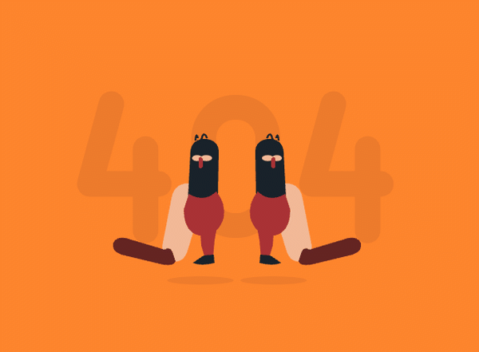
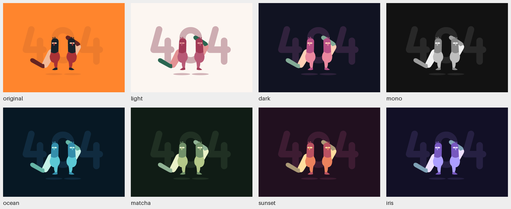

# Tangerine tumble 404

Two little figures kick their long legs in front of a huge orange-on-orange 404. Ground shadows and simple facial features keep the figures readable in silhouette.

| | |
| --- | --- |
| **Category** | [Web › Error Pages](../) |
| **Size** | 576 × 423 |
| **Colorways** | original, light, dark, mono, ocean, matcha, sunset, iris |
| **Fonts** | System sans-serif and monospace |
| **Icons** | Original procedural SVG geometry |
| **Animated** | 6 seconds, 24 fps |
| **Based on** | [A TikTok by @paulcodes4](https://www.tiktok.com/@paulcodes4/video/7693454616943545620) |

## Every colorway

## Files

- Open [the editable drawing](source/design.html) to watch the loop. Append a colorway such as `#ocean` or use `?t=3.5#original` to pause it.
- The [exports](exports/) include a full-size still and H.264 loop in every colorway.

## Changing it

Both characters use separate upper bodies, joints, legs and shoes. Their kicks alternate on independent keyframes. Each color token lives in the palette blocks at the top of the HTML. Run `python3 .github/scripts/export_design.py web/error-pages/tangerine-tumble-404` to refresh the media.
