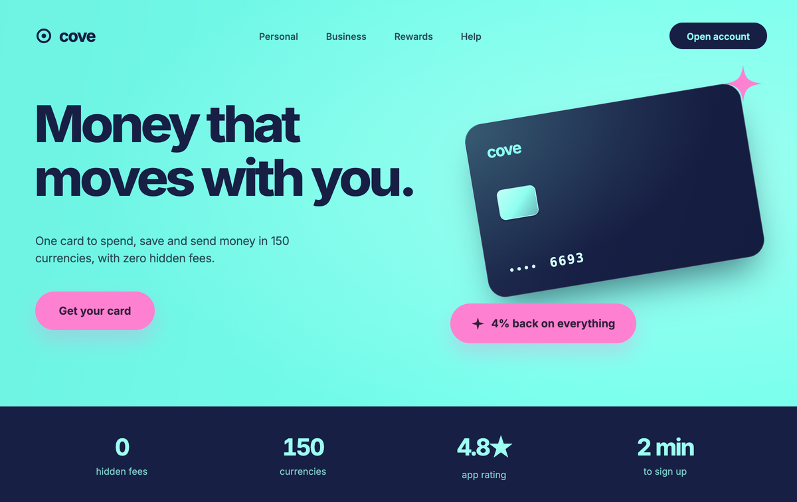
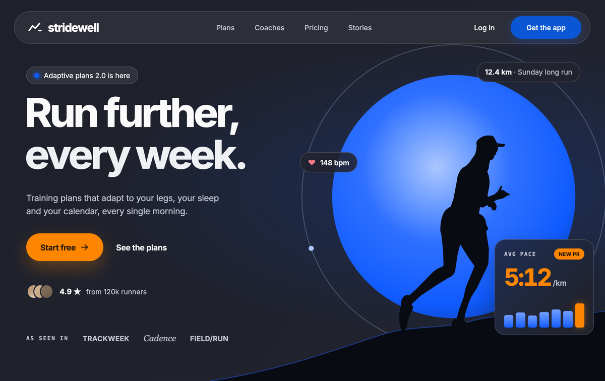
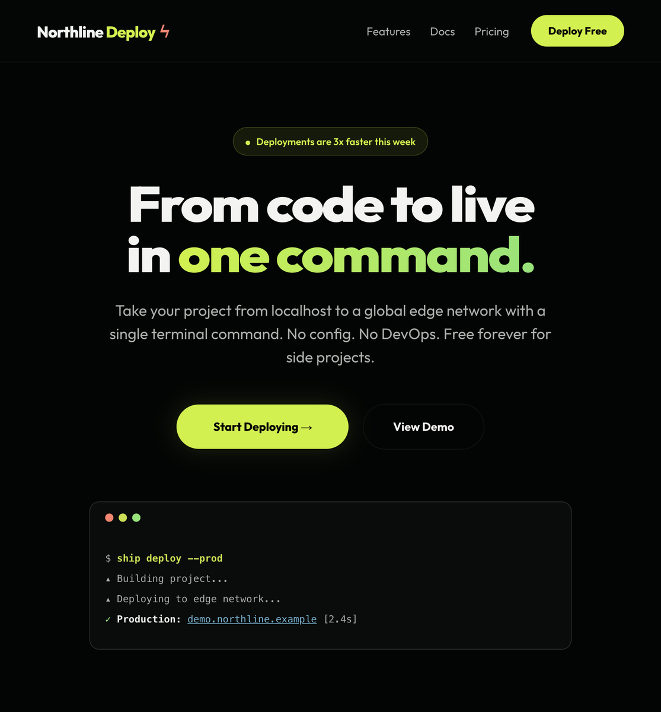
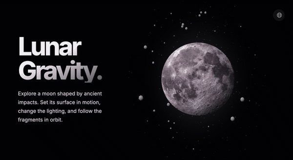
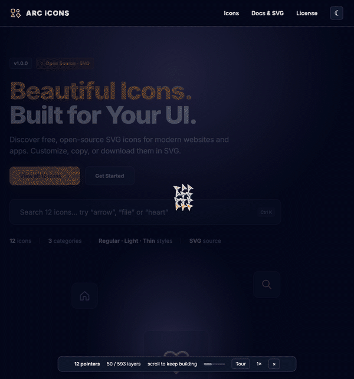
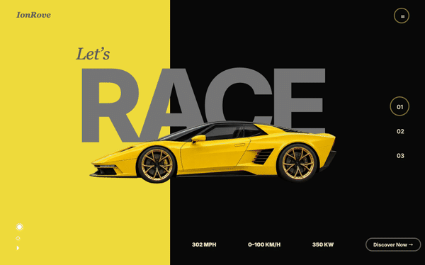
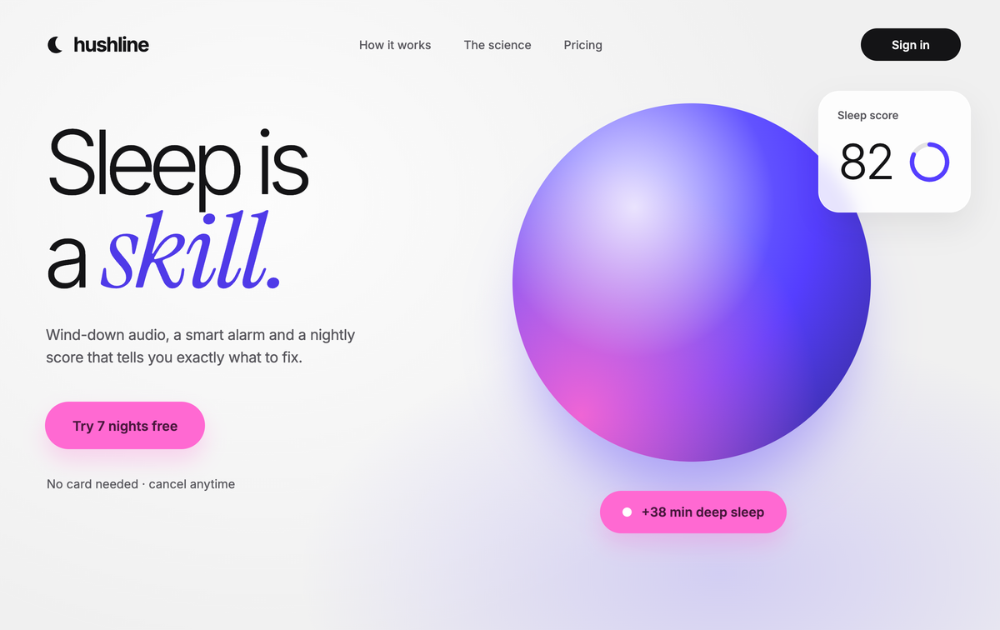

<!-- Generated by .github/scripts/build_catalog.py. Edit that file, not this one. -->
# Landing pages

Landing pages.

Part of [Web](../).

## Designs (9)

<table>
<tr><td align="center" valign="top" width="33%"> <a href="alpine-destination-carousel/"><b>Alpine destination carousel</b></a> 8 colorways</td><td align="center" valign="top" width="33%"> <a href="aqua-cashback-card/"><b>Aqua cashback card</b></a> 8 colorways</td><td align="center" valign="top" width="33%"> <a href="blue-orbit-run/"><b>Blue orbit running hero</b></a> 8 colorways</td></tr>
<tr><td align="center" valign="top" width="33%"> <a href="heart-hug-valentine/"><b>Heart hug Valentine</b></a> 8 colorways</td><td align="center" valign="top" width="33%"> <a href="lime-command-deploy/"><b>Lime command deploy</b></a> 8 colorways</td><td align="center" valign="top" width="33%"> <a href="lunar-gravity/"><b>Lunar gravity</b></a> 8 colorways</td></tr>
<tr><td align="center" valign="top" width="33%"> <a href="midnight-icon-library/"><b>Midnight icon library</b></a> 8 colorways</td><td align="center" valign="top" width="33%"> <a href="race-garage-slider/"><b>Race garage slider</b></a> 8 colorways</td><td align="center" valign="top" width="33%"> <a href="violet-sleep-sphere/"><b>Violet sleep sphere</b></a> 8 colorways</td></tr>
</table>

Adding one? See [Adding a design](../../README.md#adding-a-design).
