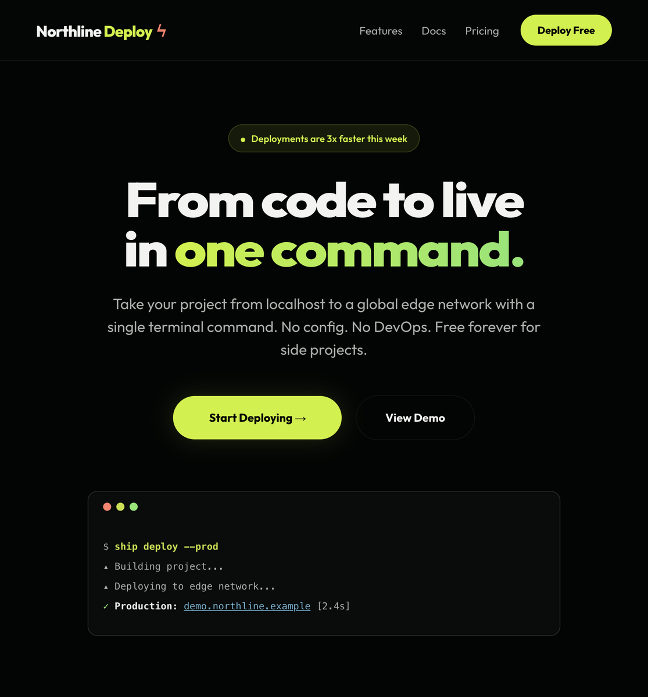
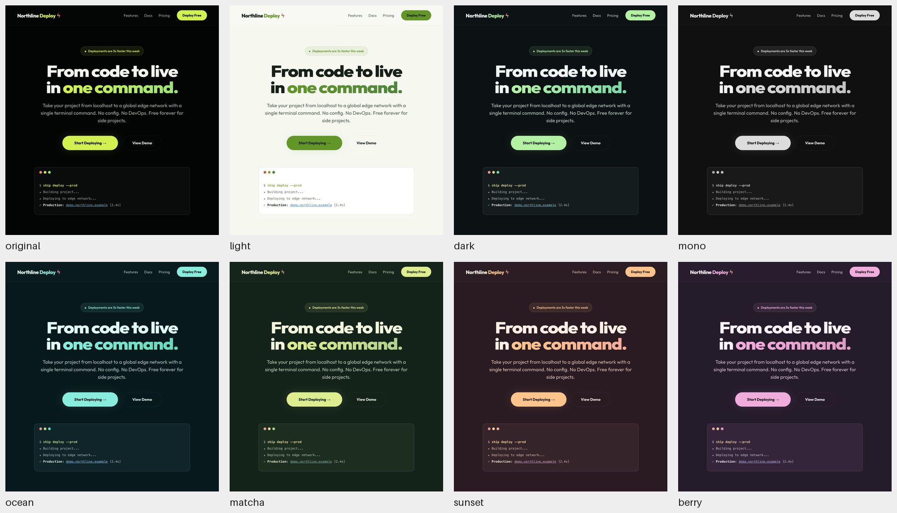

# Lime command deploy

A black developer-tool landing page pairs lime-green typography and pill buttons with a compact terminal preview. On phones, the navigation collapses and the feature cards form a single vertical list.

| | |
| --- | --- |
| **Category** | [Web › Landing pages](../) |
| **Size** | 880 × 947 CSS pixels, exported at 2× |
| **Colorways** | original, light, dark, mono, ocean, matcha, sunset, berry |
| **Fonts** | Outfit, bundled under the SIL Open Font License |
| **Artwork** | Original neutral product identity, terminal presentation and responsive page layout. |
| **Animated** | No. The layout adapts to viewport width and supports manual scrolling. |
| **Based on** | [A TikTok by @paulcodes4](https://www.tiktok.com/@paulcodes4/video/7693616882892573972), [desktop deployment demonstration](https://www.tiktok.com/@paulcodes4/video/7704577636345154837) and [repeated desktop demonstration](https://www.tiktok.com/@paulcodes4/video/7693142601016380693) |

## Every colorway

## Files

- [Open the standalone design](source/design.html). Use the header or hero controls to reach the terminal and feature sections. Resize the viewport to see the phone layout.
- Add `#ocean` to switch palettes.
- [Exports](exports/) holds a PNG for each colorway.

## Changing it

Edit the palette variables at the top of [the source](source/design.html), then run `python3 .github/scripts/export_design.py web/landing-pages/lime-command-deploy` from the repository root.
