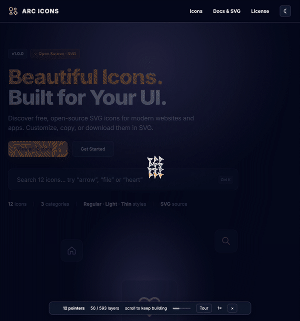
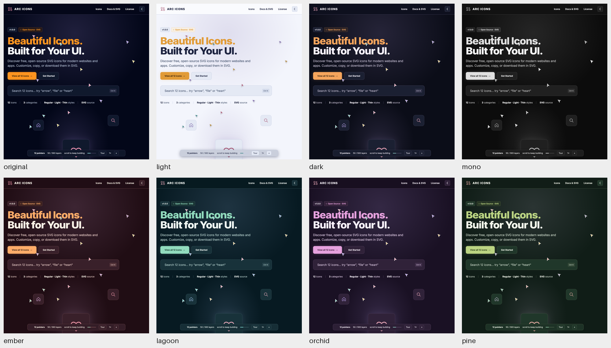

# Midnight icon library

An orange-and-white icon library opens against an ink-blue glow. A small swarm of colored pointers assembles its headline, search field and floating glyph tiles.

| | |
| --- | --- |
| **Category** | [Web › Landing pages](../) |
| **Size** | 816 × 874 CSS pixels, exported at 2× |
| **Colorways** | original, light, dark, mono, ember, lagoon, orchid, pine |
| **Fonts** | Inter (bundled Latin subset from Google Fonts, SIL Open Font License) |
| **Icons** | Original inline SVG and CSS |
| **Animated** | Yes, 4-second loop at 24 fps |
| **Based on** | [A TikTok by @paulcodes4](https://www.tiktok.com/@paulcodes4/video/7706063745092439317) |

## Every colorway

## Files

- Open [the design](source/design.html) in a browser and append `#ember` to select that colorway. Add `?t=2.45#ember` after the filename to show the export still.
- [The exports folder](exports/) contains a PNG and an H.264 MP4 loop for each colorway.
- [The font folder](source/fonts/) includes the font files and their licenses.

## Changing it

The page recreates the completed library hero and its on-screen build tour. Twelve original SVG glyphs are available through the search field. Choose a glyph to copy its SVG, and use the tour control to replay the assembly.

The custom properties at the top of `source/design.html` define each palette. Copy a palette block, give it a new colorway name, then run `python3 .github/scripts/export_design.py web/landing-pages/midnight-icon-library` from the repository root.
