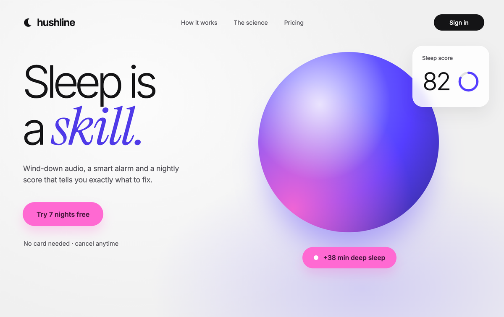
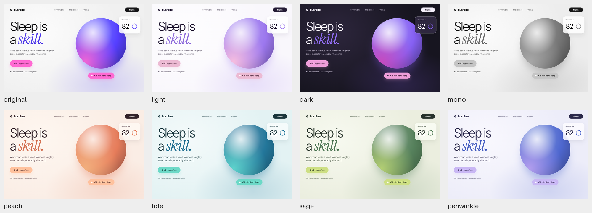

# Violet sleep sphere

A sleep-tracking landing page pairs a light sans-serif headline and italic serif word with a violet sphere, a sleep-score ring and two pink pills.

| | |
| --- | --- |
| **Category** | [Web › Landing pages](../) |
| **Size** | 1200 × 756 CSS pixels, exported at 2× |
| **Colorways** | original, light, dark, mono, peach, tide, sage, periwinkle |
| **Fonts** | Inter and Instrument Serif (bundled Latin subsets from Google Fonts, SIL Open Font License) |
| **Icons** | Original inline SVG and CSS |
| **Animated** | No |
| **Based on** | [A TikTok by @ryannaghib](https://www.tiktok.com/@ryannaghib/video/7707006807717301518) |

## Every colorway

## Files

- Open [the design](source/design.html) in a browser and append `#peach` to select that colorway.
- [The exports folder](exports/) contains a PNG for each colorway.
- [The font folder](source/fonts/) includes the font files and their licenses.

## Changing it

The sphere, score ring and crescent use CSS and original SVG. The original colorway follows the final palette at 9.5 seconds. The screenshots use static landing-page controls.

The custom properties at the top of `source/design.html` define each palette. Copy a palette block, give it a new colorway name, then run `python3 .github/scripts/export_design.py web/landing-pages/violet-sleep-sphere` from the repository root.
