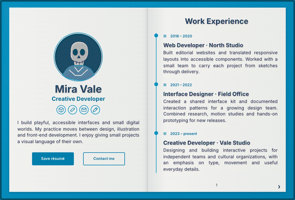
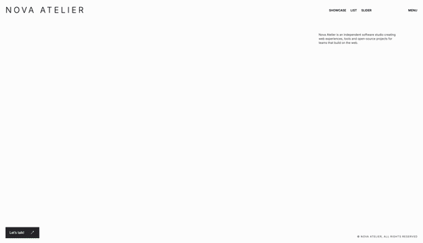

<!-- Generated by .github/scripts/build_catalog.py. Edit that file, not this one. -->
# Portfolios

Creative portfolio sites.

Part of [Web](../).

## Designs (2)

<table>
<tr><td align="center" valign="top" width="33%"> <a href="azure-foldout-portfolio/"><b>Azure foldout portfolio</b></a> 8 colorways</td><td align="center" valign="top" width="33%"> <a href="paper-project-reel/"><b>Paper project reel</b></a> 8 colorways</td></tr>
</table>

Adding one? See [Adding a design](../../README.md#adding-a-design).
