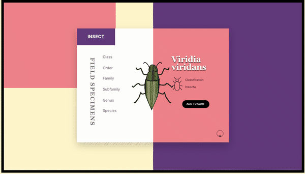
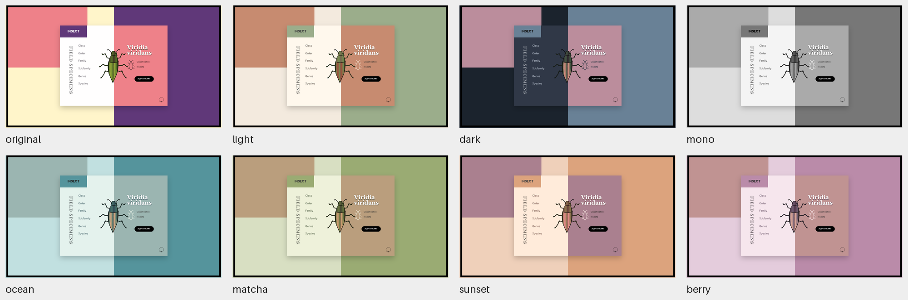

# Color-block beetle specimens

A split-color specimen shop pairs a taxonomy index with original jewel and stag beetle illustrations. Saturated blocks exchange colors as the selected specimen changes.

| | |
| --- | --- |
| **Category** | [Web › Product pages](../) |
| **Size** | 472 × 269 CSS pixels, exported at 2× |
| **Colorways** | original, light, dark, mono, ocean, matcha, sunset, berry |
| **Fonts** | Georgia for specimen names and Inter for the index. The HTML embeds Inter under its SIL Open Font License. |
| **Artwork** | Original SVG and CSS |
| **Animated** | Yes, 5.65-second loop at 24 fps |
| **Based on** | [A TikTok by @paulcodes4](https://www.tiktok.com/@paulcodes4/video/7695800492835753237) |

## Every colorway

## Files

- [Open the standalone design](source/design.html). Select a taxonomic rank, switch specimens with the arrow or keyboard, or add the current specimen to the local cart.
- Add `#ocean` to switch palettes or `?t=0.96#ocean` to freeze the preview.
- [Exports](exports/) contains a PNG and an H.264 MP4 for every colorway.

## Changing it

The CSS variables at the top of `source/design.html` control the palette. Copy a palette block, rename it, then run `python3 .github/scripts/export_design.py web/product-pages/color-block-beetle-specimens` from the repository root.
